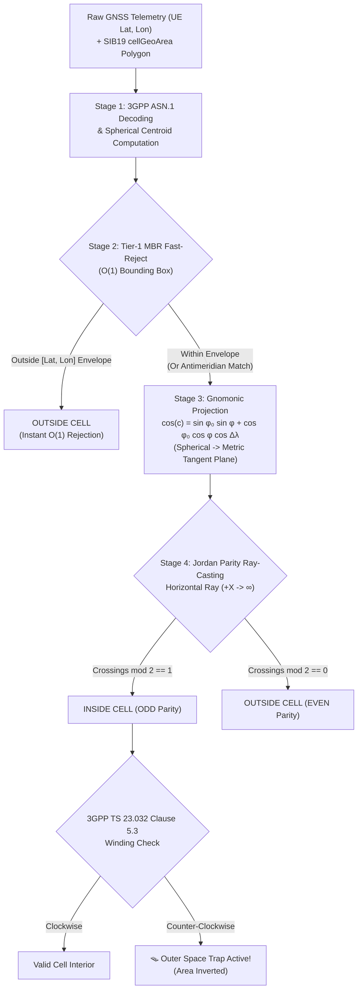

# AMAN.GNOMON-NTN — 3D/2D Satellite Cell Area Simulator

[](https://www.3gpp.org/DynaReport/23032.htm)
[](https://www.3gpp.org/DynaReport/38331.htm)
[](https://amanbh2.github.io/gnomonNTN/)
[](https://amanbh2.github.io/portfolio/)

> **Interactive 3D geodesic satellite cell simulator and Gnomonic projection engine conforming to 3GPP TS 23.032 Clause 5.3 & 3GPP TS 38.331 SIB19 `cellGeoArea`.**

---

## 🛰️ Live Interactive Demo

🚀 **Experience the Live Application:** [**https://amanbh2.github.io/gnomonNTN/**](https://amanbh2.github.io/gnomonNTN/)

---

## 🌐 The Geodesic Problem in 5G Non-Terrestrial Networks (NTN)

In terrestrial 5G networks, cell coverage areas are small (typically $0.5$ to $2\text{ km}$ across) and can be treated as planar Euclidean surfaces. In Non-Terrestrial Networks (NTN) with Low Earth Orbit (LEO) satellites operating at altitudes of $500\text{--}1200\text{ km}$, a single satellite beam illuminates a footprint spanning **$100\text{--}1000\text{ km}$** across Earth's curved spherical surface.

### Why Flat 2D Planar Math Fails:
1. **Curved Earth Distortion:** The shortest path between any two points on Earth is a **geodesic curve (great circle arc)**, not a straight line on a flat Mercator or equirectangular projection.
2. **Catastrophic Edge Errors:** Naive point-in-polygon ray-casting directly on latitude/longitude degrees results in boundary errors of up to **$150\text{--}200\text{ km}$**, causing User Equipments (UEs) to misjudge cell residency, trigger false handovers, or fail initial cell selection under `SIB19`.
3. **The Gnomonic Mathematical Breakthrough:** When points on a sphere are projected from Earth's center onto a local plane tangent to the cell Centroid $(\phi_0, \lambda_0)$, **all great circles project into exact straight line segments**. This allows exact, distortion-free $O(N)$ Jordan curve ray-casting!

```
                                  [ LEO Satellite ]
                                         │
                                         ▼ (Conical RF Beam)
                                      .-----.
                                    /         \  <- Curved Earth
                              _____/___·_______ \_____
                             /         ^ Centroid     \
                            /    [Tangent Plane]       \
                           /   (Great circles become    \
                                  straight lines!)
```

---

## ⚡ Algorithmic Pipeline Architecture



### The 4 Stages:
1. **Stage 1: 3GPP ASN.1 Decoding & 3D Spherical Centroid:**
   Converts 23-bit latitude and 24-bit longitude integers into radian vectors and averages unit normal vectors to resolve the $\pm 180^\circ$ antimeridian jump without numeric discontinuities.
2. **Stage 2: Tier-1 Minimum Bounding Rectangle (MBR) Fast-Reject:**
   Filters out 95%+ of distant UEs in $O(1)$ time with native longitudinal interval splitting for cells crossing the International Date Line:
   $$\lambda_{UE} \in [\lambda_{min\_east}, +180^\circ] \cup [-180^\circ, \lambda_{max\_west}]$$
3. **Stage 3: Gnomonic Tangent Plane Projection:**
   Projects spherical vertices and the UE location onto the tangent plane touching at the cell Centroid:
   $$\cos c = \sin\phi_0 \sin\phi + \cos\phi_0 \cos\phi \cos(\lambda - \lambda_0)$$
   $$x = \frac{\cos\phi \sin(\lambda - \lambda_0)}{\cos c}, \quad y = \frac{\cos\phi_0 \sin\phi - \sin\phi_0 \cos\phi \cos(\lambda - \lambda_0)}{\cos c}$$
   Metric coordinates: $X_{km} = R \cdot x, \quad Y_{km} = R \cdot y$.
4. **Stage 4: Jordan Curve Parity Ray-Casting & TS 23.032 Right-Hand Rule:**
   Shoots an animated ray along $+X$ and counts intersections. Validates Clockwise winding order to prevent the infamous 3GPP outer space inversion trap!

---

## 🪟 Interactive Dual-View Simulator Features

- **Left: Interactive 3D Earth Globe (Three.js):**
  - Atmospheric rim glow, starry deep space backdrop, procedural high-res vector continent maps, and lat/lon graticules.
  - Animated LEO satellite orbit with real-time 3D conical beam illuminating the ground cell.
  - True **geodesic edges** hugging Earth's curvature via Spherical Linear Interpolation (SLERP).
  - Amber glowing centroid beacon and interactive draggable UE test marker.
- **Right: 2D Gnomonic Tangent Plane Canvas:**
  - Metric coordinate grid with kilometer markers (+X East, +Y North).
  - Exact straight line edges displaying the mathematical proof of Gnomonic geometry.
  - Animated laser ray shooting horizontally with glowing collision pings at edge intersections.
  - **Bidirectional Dragging:** Dragging the UE or vertices on the 2D plane immediately updates the 3D globe and vice versa!
- **Real-Time Telemetry HUD:**
  - High-visibility `INSIDE CELL` / `OUTSIDE CELL` badge with live status telemetry.
  - Tier-1 MBR check status, spherical centroid coordinates, Gnomonic factor $\cos c$, local tangent distance, and ray crossing parity.
  - Live 3GPP TS 38.331 ASN.1 bitfield inspector stream.
- **5 Comprehensive Presets (Prominent Regional Footprints):**
  1. *Regional LEO Hexagonal Beam* (6 vertices, Central & Western Europe, ~1,800 km diameter).
  2. *Triangular Sector Macro Beam* (3 vertices, minimum allowed under TS 23.032, Western North America, ~1,600 km span).
  3. *Irregular Coastline / Border Cell* (14 vertices, maximum TS 23.032 resolution, Mediterranean Basin, ~2,200 km span).
  4. *180° Antimeridian Crosser* (Fiji/Tonga/Samoa beam spanning $+170^\circ\text{E}$ to $-170^\circ\text{W}$, ~2,200 km across).
  5. *High-Latitude Polar Macro Cell* (Arctic Ocean / Svalbard $70^\circ\text{N}\text{--}86^\circ\text{N}$, showing severe Mercator distortion vs flat Gnomonic geometry).
- **Code & Theory Drawers:**
  - Tabbed viewer comparing production C99 implementation (`isLocationInCellGeoArea.c`) with browser runtime (`gnomonPip.js`).
  - One-click copy, download, and deep-dive theoretical derivations.

---

## 🛠️ Zero-Build Tech Stack

Designed specifically for **instant zero-build deployment** on **GitHub Pages**:
- **HTML5 + Vanilla ES6 JavaScript (Modules) + Modern CSS3**
- **Three.js (r128)** + `OrbitControls` via CDN
- **HTML5 2D Canvas** for the Gnomonic Tangent Plane
- No npm, webpack, or bundler required. Simply push to `main` and it’s live!

---

## 📁 Repository Structure

```
gnomonNTN/
├── index.html              # Main single-page application entry point
├── css/
│   └── style.css           # Mission-control design system & responsive layout
├── js/
│   ├── app.js              # Application controller & view synchronization
│   ├── gnomon-pip.js       # Core mathematical & 3GPP evaluation engine
│   ├── globe-view.js       # Three.js 3D Earth, satellite orbit & geodesic SLERP
│   ├── plane-view.js       # 2D Gnomonic tangent plane canvas & ray-casting
│   └── code-snippets.js    # C99 & ES6 source code for inspection modal
├── res/
│   └── favicon.svg         # High-resolution vector satellite orbit icon
├── LICENSE                 # Open-source license
└── README.md               # Repository documentation & mathematical guide
```

---

## 📚 Standards & References

- **3GPP TS 23.032 Clause 5.3:** Universal Geographical Area Description (GAD) — *Polygon Geographical Area*.
- **3GPP TS 38.331 Clause 6.3.2:** Radio Resource Control (RRC) protocol specification — *SystemInformationBlockType19 (`SIB19`), `cellGeoArea`*.
- **Aman Bhaskar's 5G RAN Notes:** [5G RAN Note #51: NTN Geographic Cell Area Modeling & PIP Engine](https://amanbh2.github.io/learning/#/5g-ran/51-ntn-geographic-cell-modeling)
- **Portfolio:** [https://amanbh2.github.io/portfolio/](https://amanbh2.github.io/portfolio/)

---

## 👨‍💻 Author

Engineered with ❤️ & AI by **Aman Bhaskar**  
- **Website:** [amanbh2.github.io/portfolio](https://amanbh2.github.io/portfolio/)  
- **Knowledge Base:** [amanbh2.github.io/learning](https://amanbh2.github.io/learning/)  
- **GitHub:** [@amanbh2](https://github.com/amanbh2)
